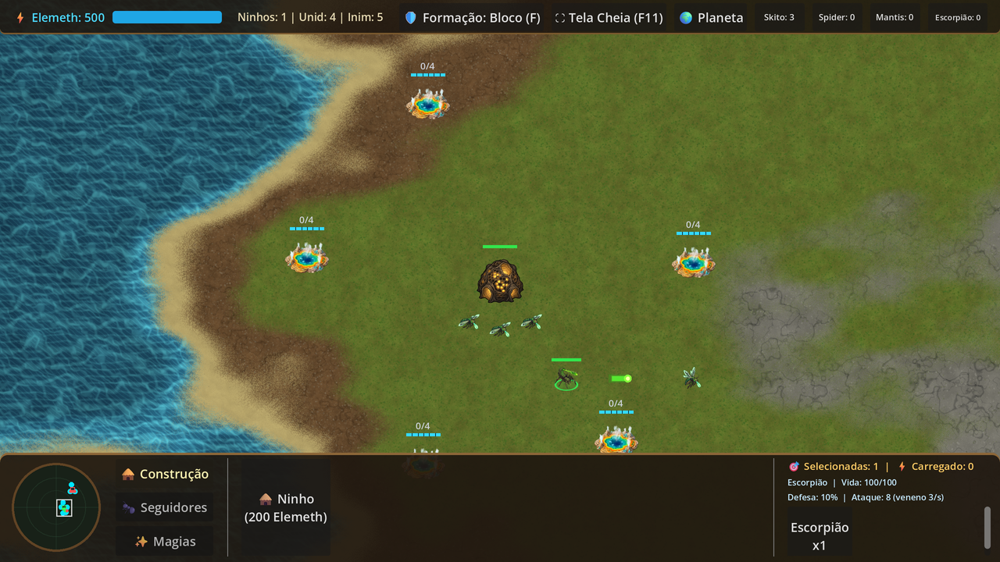

# Elementio

**Versão atual:** `0.01.000` (alpha) • [Todas as versões](https://github.com/cleomarschmitzhaus/Elementio/releases)

Elementio é um jogo de estratégia em tempo real com formigas, aranhas, mantis, skitos e escorpiões em um planeta vivo.

## Download

O download da versão Windows está disponível na release:

**[Baixar Elementio 0.01.000 para Windows (RAR)](https://github.com/cleomarschmitzhaus/Elementio/releases/download/v0.01.000/Elementio-0.01.000-Windows.rar)**

- Tamanho: **41,8 MB**
- Requisitos: Windows 10/11 64-bit
- Conteúdo: `Elementio.exe` + `LEIA-ME.txt`
- SHA-256: `9E7293083768DC44C23CAF5D72BED3B40034C0E2EAA3170E09B2A3EF2FAF332F`

1. Baixe o arquivo `.rar`.
2. Extraia todo o conteúdo para uma pasta.
3. Execute `Elementio.exe`.

## Controles

- **Mouse esquerdo:** selecionar unidade; arraste para selecionar um grupo.
- **Mouse direito:** mover unidades ou atacar um alvo.
- **Bordas da tela:** movem a câmera; a roda do mouse aproxima/afasta.
- **WASD / setas:** mover a câmera.
- **F:** alternar a formação das unidades.
- **1–9:** selecionar grupo de controle (`Ctrl` + número para definir).
- **Esc:** abrir/fechar Opções e pausar a partida.
- **F11:** alternar tela cheia.

## Menu de opções

- **Jogo:** velocidade do jogo, velocidade de rolagem, rolagem nas bordas e barras de vida.
- **Áudio:** volumes geral, música e efeitos.
- **Vídeo:** tela cheia.

As configurações são salvas automaticamente em `user://elementio_settings.cfg`.

## Versionamento

O projeto usa o formato `0.xx.xxx`:

- `0` — versão alpha.
- `xx` — mudanças importantes.
- `xxx` — mudanças menores.

Versão atual: **0.01.000**.

## Desenvolvimento

- Engine: Godot 4.7.2
- Build: Windows x86_64
- Testes automatizados: suíte headless com 240 verificações
